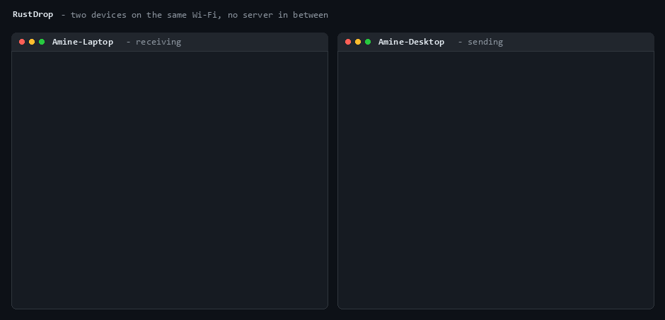

# RustDrop

> AirDrop-style file and text transfer over your local network — no cloud, no account, no pairing. A single Rust binary that finds nearby devices over UDP broadcast and streams files to them over TLS.

[](https://github.com/Vaypeee/rustdrop/actions/workflows/ci.yml)
[](https://www.rust-lang.org/)
[](LICENSE)



## Why I built it

I wanted a hands-on project to learn **async Rust and network programming from the socket up**: no
web framework, no hidden magic. RustDrop implements its own service-discovery protocol, its own
length-prefixed wire protocol, and its own TLS identity management on top of `tokio` and `rustls`.

## Features

- **Zero-configuration discovery** — devices announce themselves over UDP broadcast and expire after 10s of silence; no central server, no manual IP entry.
- **Authenticated, encrypted transfers** — TLS 1.3 (`rustls`) with a self-signed certificate per device, pinned to the SHA-256 fingerprint the peer broadcast: a host that cannot present that exact certificate, and prove it holds the key, never gets the data.
- **Streaming, constant memory** — files are sent in 64 KB chunks and written as they arrive, so a 10 GB file uses the same memory as a 10 KB one.
- **Text + link sharing** — `rustdrop text "..."` prints the message on the receiver without ever touching its disk, turns URLs into clickable OSC 8 terminal hyperlinks and copies them to the clipboard.
- **Ask before accepting** — the receiver prompts for every incoming transfer unless started with `--accept-all`.
- **No overwrites** — colliding filenames become `report (1).pdf`, like a browser download.
- **Cross-platform** — Linux, macOS and Windows; one binary, no runtime dependency.

## Install

```bash
cargo install --path .
```

## Usage

On the receiving machine:

```bash
rustdrop listen --accept-all
```

On the sending machine:

```bash
rustdrop send myfile.zip            # pick the peer interactively
rustdrop send myfile.zip --to Laptop # or target it by name / index
rustdrop text "https://example.com"  # send a message or a link
```

Other commands:

```bash
rustdrop list-peers --watch   # live view of devices on the network
rustdrop identity             # show this device's certificate fingerprint
rustdrop identity --regenerate
```

Global options: `-n/--device-name <NAME>`, `-p/--port <PORT>` (default 9000), `-v/--verbose`.

## How it works

```
            UDP :8765 broadcast                      TCP :9000 + TLS
  Device A ──── announcement ────► Device B      A ──── handshake ────►  B
  (announcer)   id, name, port,    (listener)         (A pins B's fingerprint)
                version,                          ── TransferRequest ──►
                SHA-256                           ◄──── Accept ─────────
                fingerprint                       ─── binary frames ───►
                every 2s                          ─── end of stream ───►
                                                  ◄──── Complete ───────
```

**Discovery** (`src/discovery/`) — an `Announcer` task broadcasts a JSON announcement every 2 s, a
`Listener` task binds the discovery port with `SO_REUSEADDR`/`SO_REUSEPORT` so several instances can
share it, keeps a `HashMap<Uuid, Peer>` behind an `RwLock`, drops self-announcements by instance id
and reaps peers unseen for 10 s. The peer's IP is taken from the UDP source address rather than
trusted from the payload.

**Transfer** (`src/transfer/`) — control messages (`TransferRequest`, `TextMessage`, `Accept`,
`Reject`, `Complete`, `Error`) are JSON behind a 4-byte big-endian length prefix; the file payload
then streams as raw binary frames on the same connection, because JSON-encoding a `Vec<u8>` inflates
it roughly fourfold. Every frame is size-capped so a malicious peer cannot make the receiver allocate
arbitrarily, the receiver deletes a partial file if the stream breaks, and the sender only reports
success once the receiver confirms the file is committed. One task per connection, so several senders
can be served at once.

**Identity** (`src/security/`) — a self-signed certificate (`rcgen`) generated on first run and
stored under the platform data directory with `0600` permissions on Unix. Its SHA-256 fingerprint is
broadcast in every announcement, and the TLS client pins the certificate presented during the
handshake against it: a mismatch aborts the connection before any data is sent. The fingerprint alone
would only prove *which* certificate was shown — certificates are public — so rustls still verifies
the handshake signature, which is what proves the peer holds the private key.

## Project layout

```
src/
├── cli/         clap command definitions
├── config/      settings, ports, platform paths
├── discovery/   announcer, listener, peer model
├── security/    certificate identity, TLS config
├── transfer/    wire protocol, sender, receiver
└── error.rs     one thiserror enum for the whole crate
```

## Limitations / roadmap

This is a learning project, and I'd rather be explicit about what it does not do yet:

- **Discovery is trust-on-first-use.** The fingerprint a sender pins comes from an unauthenticated
  UDP broadcast, so the handshake proves you reached *the device that sent that announcement*, not
  that it is the laptop you meant. An attacker on the same LAN can announce themselves under any
  device name. Remembering fingerprints across runs, and warning when a known name changes
  fingerprint, is the next step.
- **IPv4 only** — no IPv6, and UDP broadcast does not cross subnets. Multicast (or mDNS) would.
- **No resume** — an interrupted transfer restarts from zero, and the partial file is deleted.
- **One file per invocation** — no directories, no multi-select.
- The end-to-end discovery test is `#[ignore]`d because CI runners do not reliably allow broadcast;
  run `cargo test -- --ignored` on a real network.

## Development

```bash
cargo test                  # 10 tests: framing, pinning, discovery model
cargo test -- --ignored     # plus the end-to-end broadcast test
cargo clippy --all-targets -- -D warnings
cargo fmt --all --check
cargo run -- --verbose listen
```

CI runs all of the above on Linux, macOS and Windows.

## License

MIT — see [LICENSE](LICENSE).
